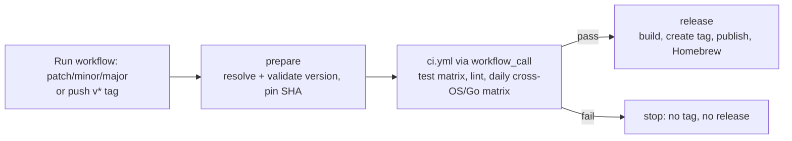

# Release Process

ghx ships two independently versioned artifacts:

| Artifact | Tag format | Workflow |
|----------|------------|----------|
| `ghx` / `ghxd` binaries | `vX.Y.Z` | [`release.yml`](.github/workflows/release.yml) |
| Agent plugin (`agent-plugin/`) | `plugin-vX.Y.Z` | [`release-plugin.yml`](.github/workflows/release-plugin.yml) |

## App release

Every release runs the full CI suite on the exact commit being released.
Nothing is tagged or published unless CI passes.



### Cutting a release (recommended)

Start the **Release** workflow from `main`, either from the
[Actions tab](https://github.com/brunoborges/ghx/actions/workflows/release.yml)
("Run workflow") or from the CLI:

```bash
gh workflow run release.yml -f bump=patch    # v1.7.1 -> v1.7.2
gh workflow run release.yml -f bump=minor    # v1.7.1 -> v1.8.0
gh workflow run release.yml -f bump=major    # v1.7.1 -> v2.0.0
gh workflow run release.yml -f version=v2.0.0-rc.1   # explicit version
```

Then follow it with `gh run watch`.

### What each job does

1. **prepare**:
   - Resolves the version. With `bump`, it increments the latest stable `vX.Y.Z` tag; `plugin-v*` and pre-release tags are ignored.
   - Checks the version format.
   - Fails if the run isn't on `main` or the tag already exists.
   - Pins the commit SHA that every later job uses.
2. **ci**: runs [`ci.yml`](.github/workflows/ci.yml) through `workflow_call` on the pinned SHA:
   - the Ubuntu/Windows test matrix with `-race`;
   - `go vet` and `gofmt`;
   - the Ubuntu/macOS/Windows × Go `stable`/`oldstable` matrix.
3. **release**: runs only if `ci` succeeds.
   - Cross-compiles darwin/linux/windows × amd64/arm64 archives with the version stamped in through `-ldflags "-X main.version=…"`.
   - Computes `checksums.txt`.
   - Creates and pushes the tag. This happens only on manual runs, after the build succeeds.
   - Publishes the GitHub release with auto-generated notes.
   - Updates the [Homebrew tap](https://github.com/brunoborges/homebrew-tap). Pre-releases (versions containing `-`) skip this step.

### Alternative: pushing a tag

Pushing a `v*` tag still works and goes through the same CI gate:

```bash
git tag -a v1.8.0 -m v1.8.0 origin/main
git push origin v1.8.0
```

If CI fails in this mode, the tag already exists. Delete it with
`git push --delete origin v1.8.0`, fix the problem, and release again.

### Choosing the bump

- **patch**: bug fixes and dependency updates.
- **minor**: new features or config options that stay backward compatible.
- **major**: breaking changes to CLI flags, config, IPC protocol, or cache semantics.

### Notes

- Releases are serialized (`concurrency: release`), so two runs can't race for the same version.
- Install scripts and `/releases/latest` consumers must filter out `plugin-v*` tags, because GitHub doesn't distinguish tag prefixes.
- The Homebrew update needs the `HOMEBREW_TAP_TOKEN` repository secret.

## Plugin release

Push a `plugin-v*` tag:

```bash
git tag -a plugin-v1.6.0 -m plugin-v1.6.0 origin/main
git push origin plugin-v1.6.0
```

`release-plugin.yml` then:

- checks the plugin structure;
- stamps the version into `.claude-plugin/plugin.json`;
- packages `ghxd-plugin-<version>.tar.gz` with a checksum;
- publishes a "Plugin plugin-vX.Y.Z" GitHub release.

The plugin downloads the latest app release at runtime, so you only need a plugin release when files under `agent-plugin/` change.
